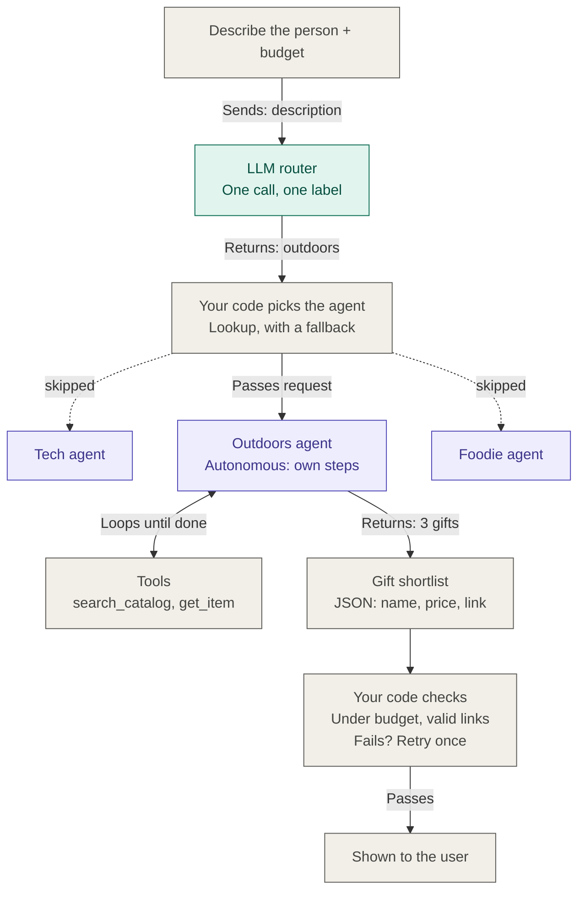
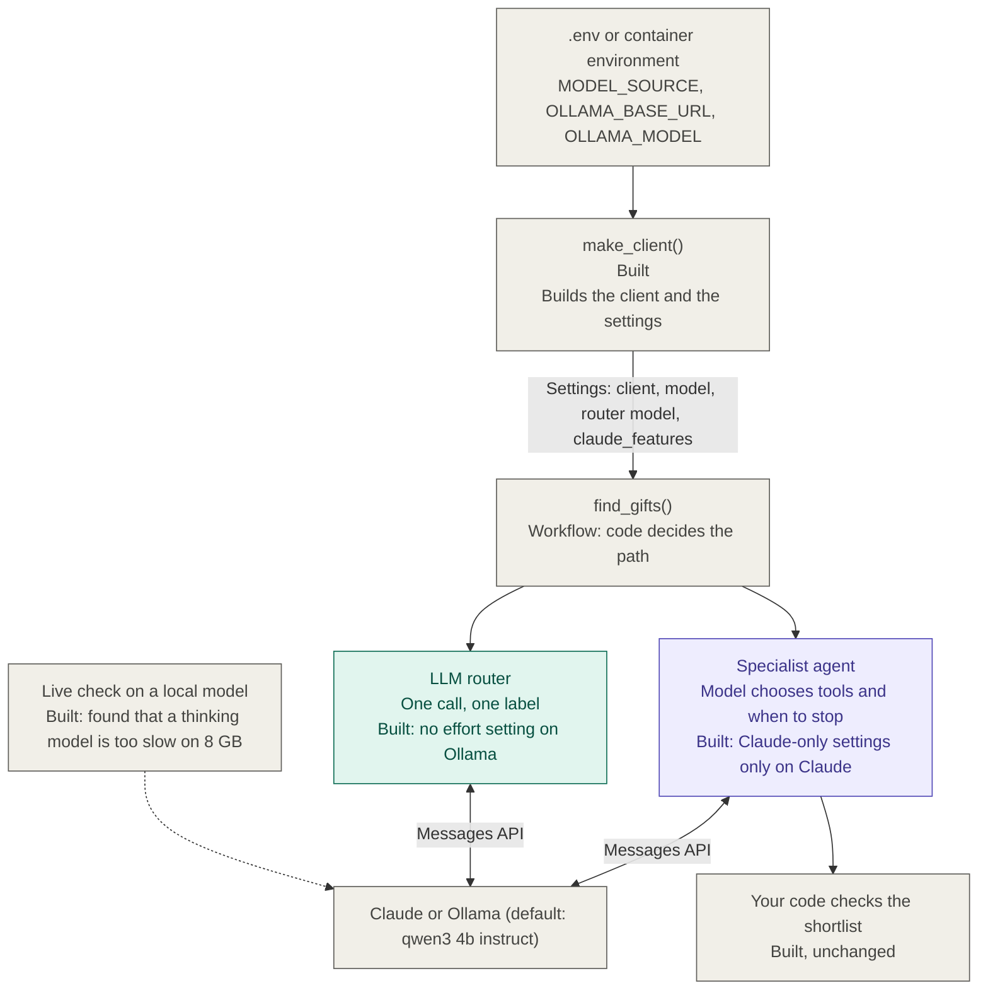
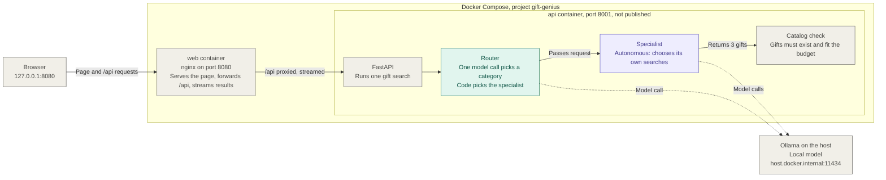

# Gift Genius

Describe the person you're buying for, enter a budget, and get three gift ideas from a
60-item catalog, each one checked by code before you see it. Two front ends share one back end:
a React web app and a command-line app.

## Pattern

**A routing workflow whose specialists are autonomous agents.** Gift requests fall into a few
clear categories (tech, outdoors, food), so one fast LLM call picks the category and plain code
picks the matching specialist, with a General agent as the fallback. But how to search the
catalog for a particular person can't be known in advance, so each specialist is an autonomous
agent that chooses its own searches, capped at 6 tool calls. Its shortlist is structured data,
and code checks it against the catalog and the budget before anyone sees it.



**Legend:** green is a single LLM call, purple is an autonomous agent, and gray is code or data.
The web app's activity feed uses the same colours for its "LLM call", "Agent" and "Code" tags.

### The steps, and where they live

| Step | Kind | Code |
|---|---|---|
| 1. Description and budget (a separate number) | code | `frontend/web`, `frontend/cli` |
| 2. Router returns one label: `tech`, `outdoors` or `foodie` | one LLM call (`ROUTER_MODEL`) | `backend/src/gift_genius/router.py` |
| 3. Label → agent; unknown labels fall back to General | code | `orchestrator.pick_agent` |
| 4. Specialist loops with `search_catalog` and `get_item`, at most 6 tool calls | autonomous agent | `agent.py` (generic loop), `agents/` (one file per agent), `tools/` (one file per tool) |
| 5. Shortlist as JSON: `item_id`, `name`, `price`, `link`, `reason` | data | `agents/specialist.py` (the format) |
| 6. Checks: exactly 3 gifts, ids in the catalog, prices at or under budget, links match the catalog. On failure, the agent runs once more with the specific problems. On a second failure, only the gifts that passed are shown, with the reasons the others were removed. | code | `validation.py`, `orchestrator.find_gifts` |
| 7. Show the result | code | web gift cards, CLI list |

A few details:
- The checks also catch a price that doesn't match the catalog, a gift listed twice, and a gift with no reason.
- Gifts that pass are rebuilt from the catalog, so the name, price and link always come from the catalog. Only the reason comes from the agent.
- The retry gets a fresh budget of 6 tool calls.
- The catalog is `backend/src/gift_genius/data/catalog.json`. The tools read only this file.

### Model source

One setting chooses a local Ollama model instead of Claude, so Gift Genius can run with no API key. The address and model name come from
environment variables, so the same image can later run in a container or a Kubernetes pod,
where `localhost` is not the machine that runs Ollama.



Every box is built.

## Setup

You need Python 3.10+ and Node 20+.

```bash
python3 -m venv .venv
.venv/bin/pip install -e "backend[dev]"
.venv/bin/pip install -e "frontend/cli[dev]"
cd frontend/web && npm install
```

`backend[dev]` includes the API dependencies. The API itself is the optional `api` extra, so a
CLI-only install (`pip install -e backend -e frontend/cli`) doesn't pull in FastAPI.

Copy `.env.example` to `.env` at the repository root and fill in either `ANTHROPIC_API_KEY`
(Claude API) or the `ANTHROPIC_FOUNDRY_*` settings (Microsoft Foundry). Optionally set
`ROUTER_MODEL` to a fast model (Claude API: e.g. `claude-haiku-5-5`; Foundry: a deployment name).
If it's empty, the router uses the main model. `.env` is git-ignored, and the key never leaves the back end.

To run with no API key, use a local model through Ollama. Set `MODEL_SOURCE=ollama` in `.env`. `OLLAMA_BASE_URL` and `OLLAMA_MODEL` are optional, and the default model is a small non-thinking one that fits an 8 GB machine. Use a model that does not think before it answers: a thinking model made each step take minutes on that hardware. If `ROUTER_MODEL` is empty, the router uses the same model. A small model can invent products, but the catalog check removes them, so you may see "No gift ideas passed the checks" instead of fake results.

## Run

CLI:

```bash
.venv/bin/gift-genius
```

```bash
.venv/bin/gift-genius --budget 40 "My dad makes espresso every morning and bakes bread on Sundays"
```

Web: start the API (port 8001) and the dev server (port 5174), then open http://127.0.0.1:5174.

```bash
.venv/bin/gift-genius-api
```

```bash
npm --prefix frontend/web run dev
```

The API listens on 127.0.0.1 only and allows 3 searches at once. It has no authentication, so
don't expose it beyond this machine without adding some.

## Docker

The whole app can run in two containers started by Docker Compose, with Ollama still running on your machine outside Docker. Nothing in the containers is a model: the images and the Compose file are plain configuration.



**Legend:** green is a single model call, purple is an autonomous agent, and gray is code or configuration. Solid arrows pass control or data, and dotted arrows are calls to the model. The web container starts only after the api container reports healthy, because nginx looks up the name `api` when it starts.

### Run with Docker Compose

You need Docker Desktop and Ollama running on your machine. Pull the default model once:

```bash
ollama pull qwen3:4b-instruct-2507-q4_K_M
```

Then start both containers from the repository root:

```bash
docker compose up --build
```

Open http://127.0.0.1:8080. Stop with Ctrl+C, then remove the containers:

```bash
docker compose down
```

No `.env` file is needed for the defaults. To change the model or the port, copy `.env.example` to `.env` and set `OLLAMA_MODEL` or `WEB_PORT`. Only the web port is published, and only on 127.0.0.1. The API has no authentication, so it stays inside the Compose network. These steps are for Docker Desktop. Docker on Linux needs an extra setting before the containers can reach Ollama on the host.

## API

`POST /api/gift-searches` with `{"description": "...", "budget": 50}` streams Server-Sent Events:

| Event | Data |
|---|---|
| `routed` | `label`, `agent`, `fallback` |
| `searching` | `attempt`, `query`, `max_price`, `matches` (one per `search_catalog` call) |
| `checking` | `attempt`, `item_id`, `found`, `name` (one per `get_item` call) |
| `validated` | `attempt`, `ok`, `problems`, `will_retry` |
| `shortlist` | `label`, `agent`, `attempts`, `gifts`, `removed`, `problems` |
| `done` | `{}` |
| `error` | `message` (safe to show; never contains secrets) |

## Tests

The model is mocked in every test.

```bash
cd backend && ../.venv/bin/pytest
```

```bash
cd frontend/cli && ../../.venv/bin/pytest
```

```bash
cd frontend/web && npm test
```

## Layout

```
backend/            gift-genius-backend (import name gift_genius)
  src/gift_genius/  __init__.py (public API), agent.py, router.py, orchestrator.py, validation.py,
                    client.py, errors.py, agents/, tools/, api/, data/catalog.json
  tests/            mirrors src/gift_genius/
frontend/web/       gift-genius-web: Vite, React, TypeScript
frontend/cli/       gift-genius-cli (import name gift_genius_cli): the gift-genius command
```
